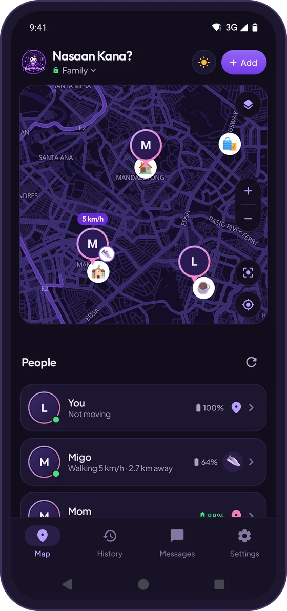
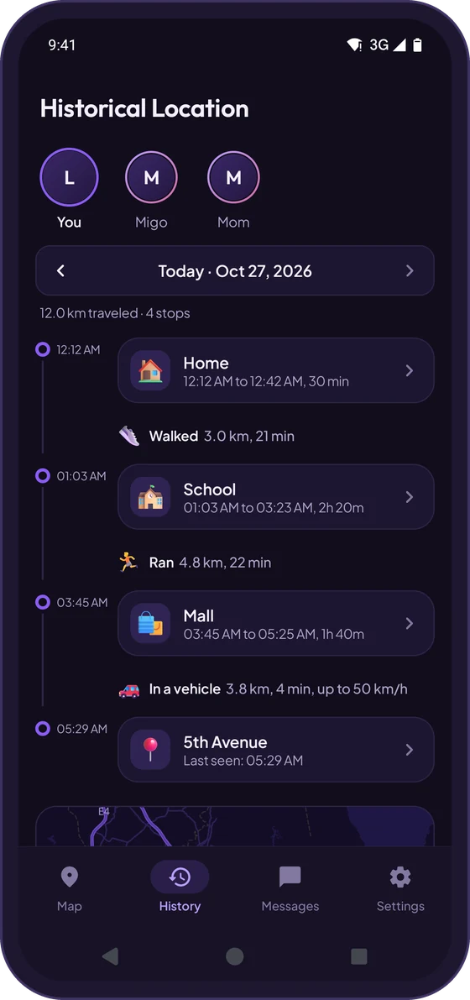
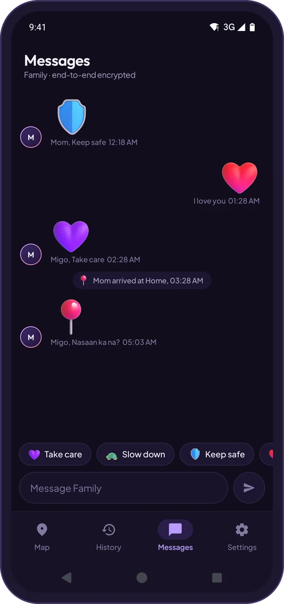
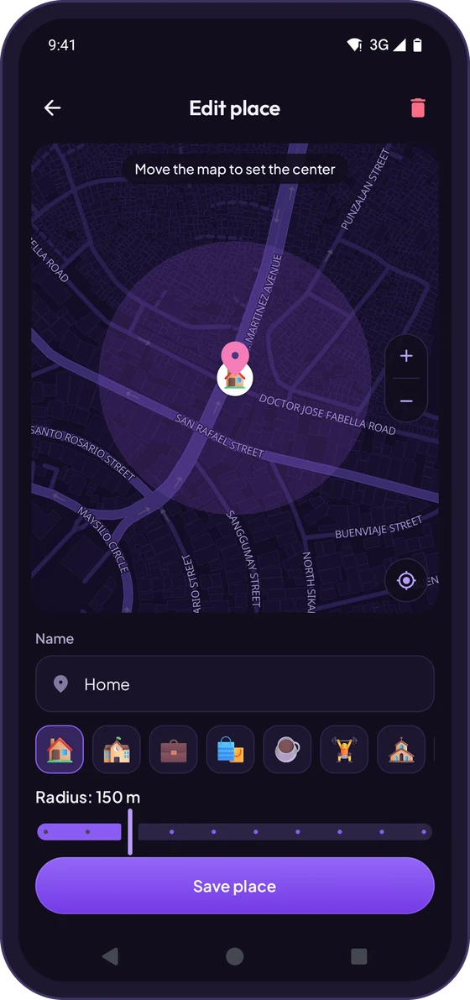
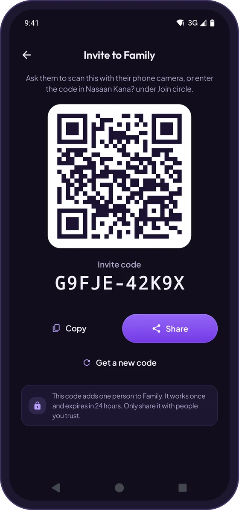

  

  

  
  
  
  

 

## Take a tour

<table>
  <tr>
    <td width="42%" align="center"></td>
    <td width="58%">
      <h3>See everyone, live</h3>
      
Your whole circle on one map. See who's home, who's on the way, how fast they're going and how much battery they have left.

      
The map goes real time the moment someone opens it, so you're never looking at an old spot.

    </td>
  </tr>
</table>

<table>
  <tr>
    <td width="33%" align="center" valign="top">
       
      <b>History</b> 
      Stops, trips and distance for the last 24 hours.
    </td>
    <td width="33%" align="center" valign="top">
       
      <b>Messages</b> 
      Quick emoji, chat and SOS. Arrivals show up on their own.
    </td>
    <td width="33%" align="center" valign="top">
       
      <b>Places</b> 
      Save Home or School and get told when someone arrives.
    </td>
  </tr>
</table>

<table>
  <tr>
    <td width="58%">
      <h3>Bring your people in</h3>
      
Show a QR code or send a short code. It works once and expires in 24 hours, so only the person you invite can join.

      
Be in up to 3 circles, with up to 10 people each.

    </td>
    <td width="42%" align="center"></td>
  </tr>
</table>

Screens show demo data.

## Private and light

<table>
  <tr>
    <td width="50%" valign="top">
       
      <b>Only your circle can see you</b> 
      Your location is locked on your phone before it's sent. Not even the server can read it.
    </td>
    <td width="50%" valign="top">
       
      <b>Easy on your battery</b> 
      GPS turns off when you're not moving and turns back on the moment you move.
    </td>
  </tr>
  <tr>
    <td valign="top">
       
      <b>Gone after 24 hours</b> 
      History and messages delete themselves. Accounts not used for 30 days are deleted too.
    </td>
    <td valign="top">
       
      <b>Pause any time</b> 
      Ghost mode stops sharing. App lock keeps the app behind your fingerprint, face or PIN.
    </td>
  </tr>
</table>

No ads, no tracking, no subscriptions.

## Download

Get the newest version from **[Releases](https://github.com/Levi-crown/NasaanKana/releases/latest)**.

| File | Pick this if |
| :--- | :--- |
| `NasaanKana-x.x.x-arm64-v8a.apk` | You have a phone from the last few years. Most people need this one. |
| `NasaanKana-x.x.x-armeabi-v7a.apk` | You have an older phone. |
| `NasaanKana-x.x.x-universal.apk` | You're not sure. It works on any phone, but it's bigger. |

**Already have it?** You get a notification when there's a new version, and you can update right inside the app from **Settings → Sharing & privacy → App update**.

**Forgot your password?** Resetting it clears your data, and you'll need a new invite to join your circles again.

## Credits

| | |
| :--- | :--- |
| **Kuromi** | Character © Sanrio Co., Ltd., shown in this app as fan art. This app is not affiliated with, sponsored or endorsed by Sanrio. |
| **Map data** | © [OpenStreetMap](https://www.openstreetmap.org/copyright) contributors (ODbL) |
| **Map tiles** | [OpenFreeMap](https://openfreemap.org) |
| **Satellite imagery** | © [Esri](https://www.esri.com), Maxar and the GIS user community |
| **Map engine** | [MapLibre Native](https://maplibre.org) (BSD-2-Clause) |
| **Emoji** | [Microsoft Fluent Emoji](https://github.com/microsoft/fluentui-emoji) (MIT) |
| **Icons** | [Phosphor Icons](https://phosphoricons.com) (MIT) |
| **QR codes** | [ZXing](https://github.com/zxing/zxing) (Apache 2.0) |

### Built with

  
  
  
  
  

Plus AndroidX (WorkManager, DataStore, Navigation, Biometric, Lifecycle) and Kotlin Coroutines.

 

  Made in the Philippines by <a href="https://github.com/Levi-crown">Levi Crown</a>

