<h1 align="center">Nasaan Kana?</h1>

<i>"Nasaan ka na?"</i> is Filipino for <b>"Where are you?"</b>

## About

Nasaan Kana? is a free Android app for family and friends. It shows the people in your circle on a live map, lets you chat with them, and lets you look back at the places they have visited. There are no ads and no subscriptions, just a simple way to stay connected with the people who matter to you.

It was made in the Philippines, but it isn't only for the Philippines. You can use it anywhere in the world, and your circle can be spread across different countries.

**A note on satellite view:** only the Satellite map is affected by this. It uses free imagery, so it isn't as sharp as the one in paid map apps. Some places may look blurry or hazy, or show older pictures, especially when you zoom in close. This is a limit of the free imagery, not of your phone or your connection. The Default and Streets maps are always sharp.

## Privacy

Nasaan Kana? is end-to-end encrypted. Your location, history, messages, photos and videos are encrypted on your phone, so only the people in your circle can see them. History, messages, photos and videos are automatically deleted after 24 hours.

 

  

  

  
  
  
  

 

## Take a tour

From creating your account to settings. Every screen comes in light and dark.

<table>
  <tr>
    <th></th>
    <th>Light</th>
    <th>Dark</th>
  </tr>
  <tr>
    <td width="34%" valign="middle">
      <h3>1. Welcome</h3>
      
Sign in, or create an account in a minute. It's free and end-to-end encrypted.

    </td>
    <td width="33%" align="center">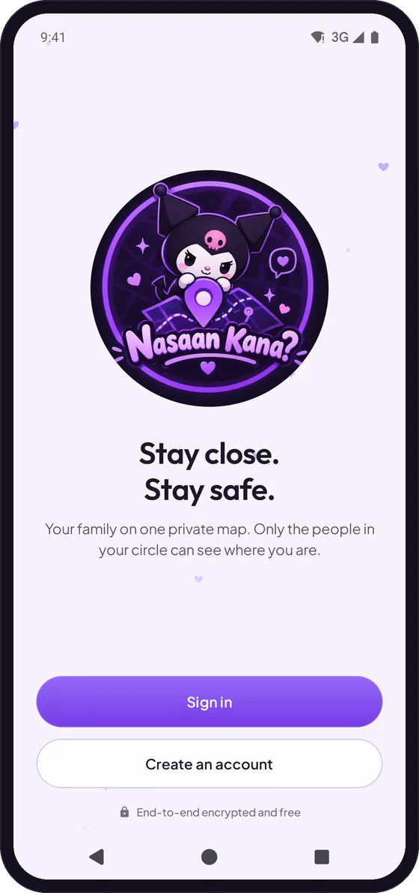</td>
    <td width="33%" align="center">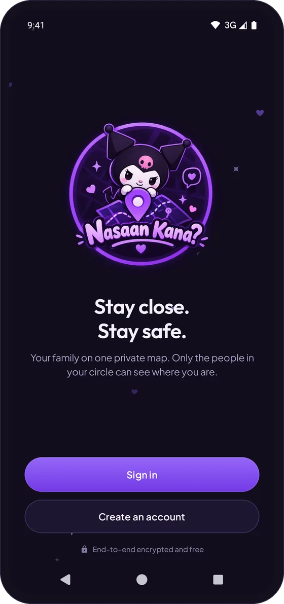</td>
  </tr>
  <tr>
    <td width="34%" valign="middle">
      <h3>2. Create your account</h3>
      
Pick the name your circle will see. Your password also locks your encryption keys, so only you can open them.

    </td>
    <td width="33%" align="center">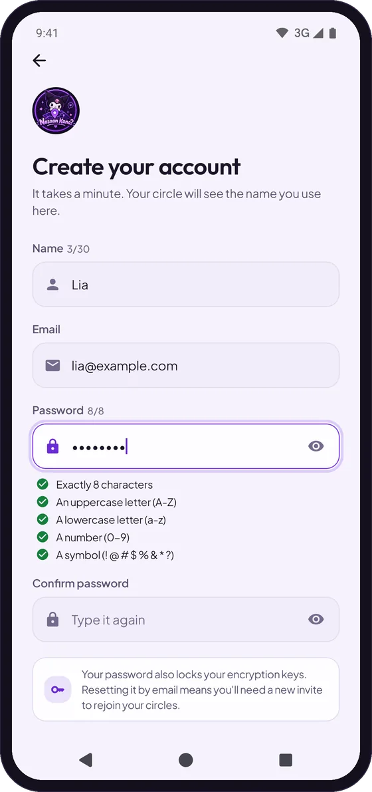</td>
    <td width="33%" align="center">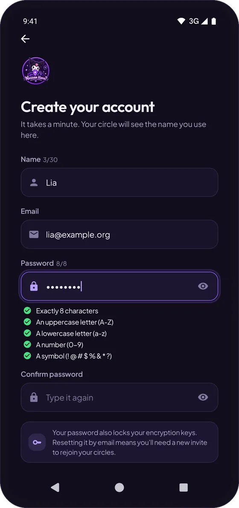</td>
  </tr>
  <tr>
    <td width="34%" valign="middle">
      <h3>3. Get set up</h3>
      
The app asks only for what it needs (location, activity, notifications and battery) and says why for each one.

    </td>
    <td width="33%" align="center">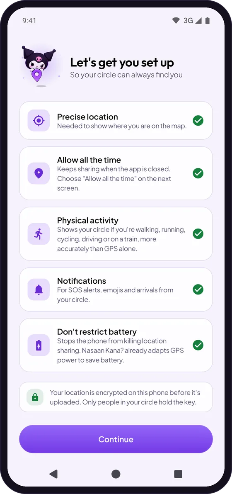</td>
    <td width="33%" align="center">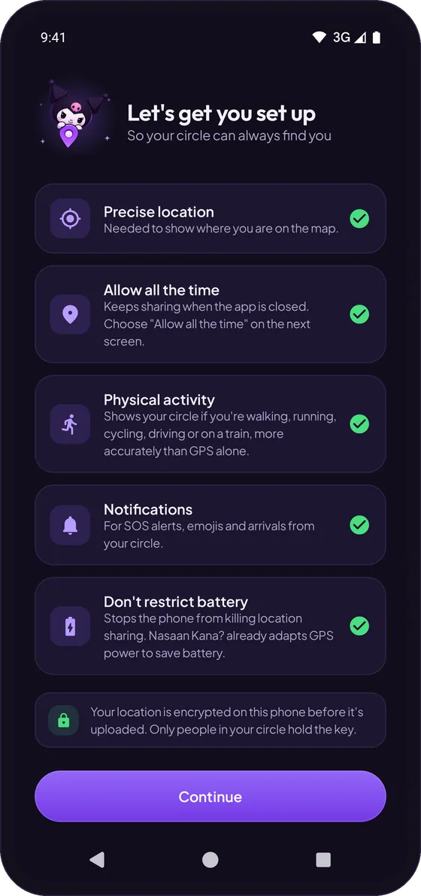</td>
  </tr>
  <tr>
    <td width="34%" valign="middle">
      <h3>4. See everyone, live</h3>
      
Your whole circle on one map: who's home, who's on the way, how fast they're going, their battery, and Wi-Fi or mobile data. Locations go live the moment someone opens the map. If someone loses signal or turns their phone off, they show as offline instead of an old spot.

    </td>
    <td width="33%" align="center">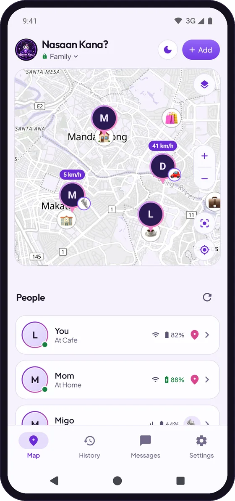</td>
    <td width="33%" align="center">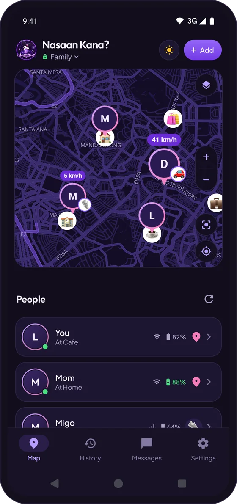</td>
  </tr>
  <tr>
    <td width="34%" valign="middle">
      <h3>5. Tap anyone</h3>
      
See their address, the weather where they are (in °C or °F), battery, speed and connection. Get directions, open their history or send a message.

    </td>
    <td width="33%" align="center">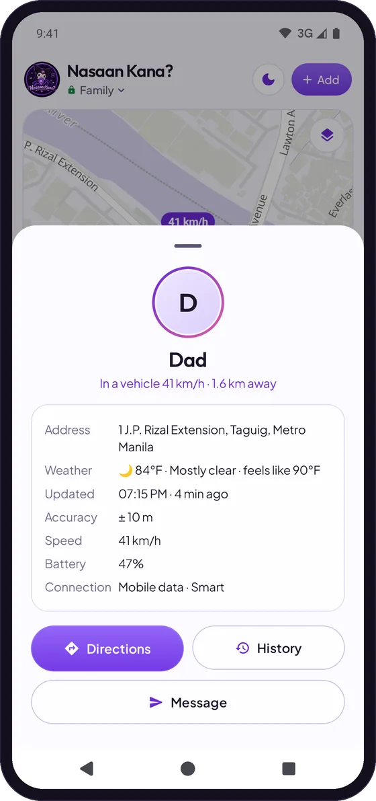</td>
    <td width="33%" align="center">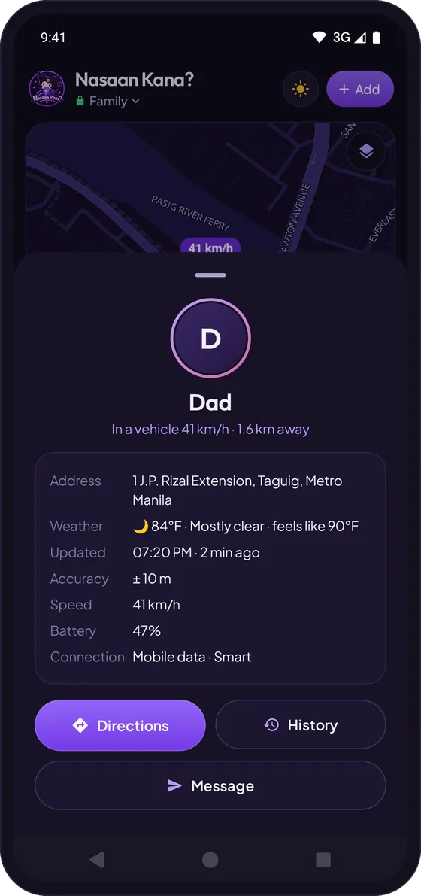</td>
  </tr>
  <tr>
    <td width="34%" valign="middle">
      <h3>6. History</h3>
      
Stops, trips and distance for the last 24 hours, by car, bike or on foot.

    </td>
    <td width="33%" align="center">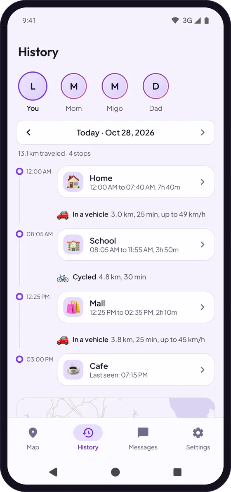</td>
    <td width="33%" align="center">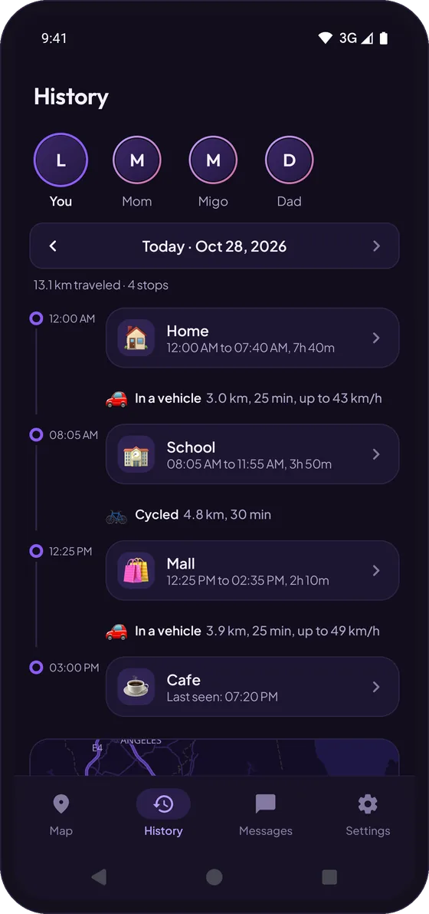</td>
  </tr>
  <tr>
    <td width="34%" valign="middle">
      <h3>7. Messages</h3>
      
Chat, photos, short videos and SOS. Tap the smiley in the message box for every emoji, right in your message. Arrivals are posted for you.

    </td>
    <td width="33%" align="center">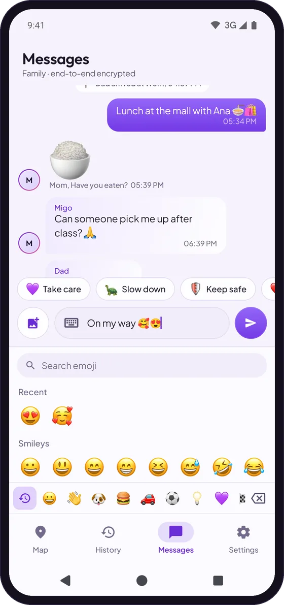</td>
    <td width="33%" align="center">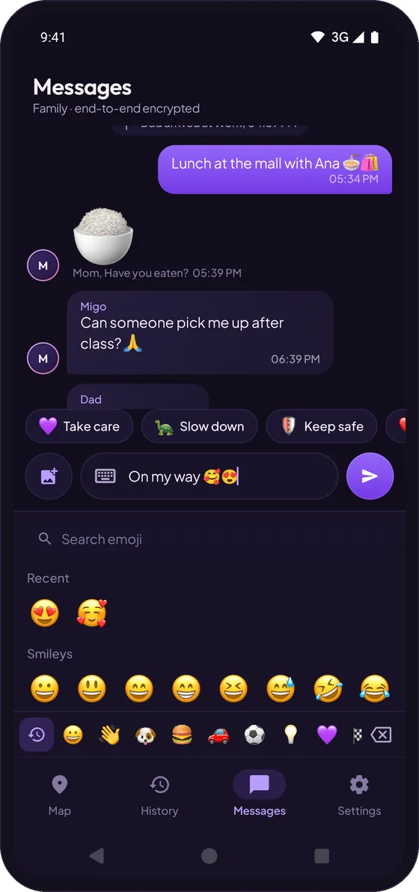</td>
  </tr>
  <tr>
    <td width="34%" valign="middle">
      <h3>8. Places</h3>
      
Save places like Home or School and get notified when someone arrives or leaves.

    </td>
    <td width="33%" align="center">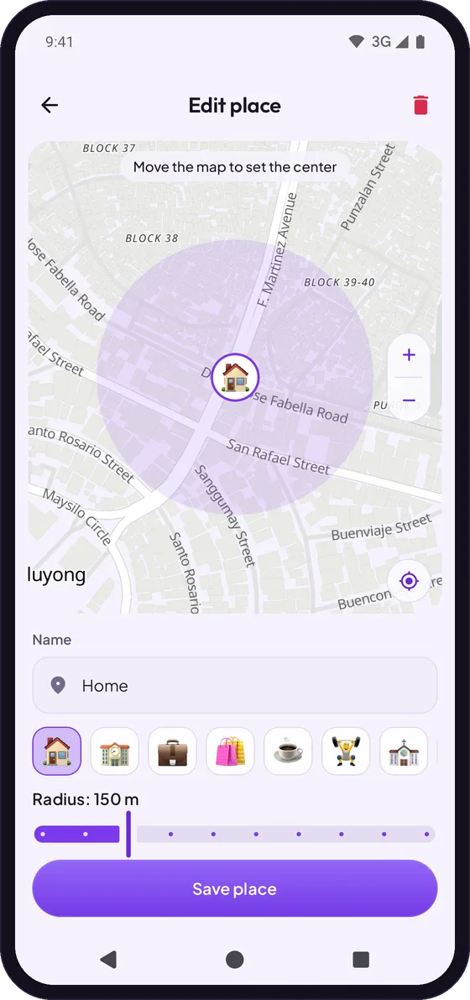</td>
    <td width="33%" align="center">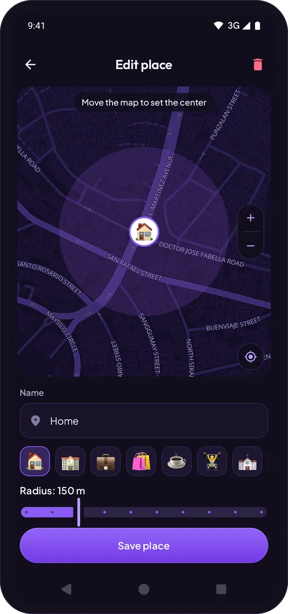</td>
  </tr>
  <tr>
    <td width="34%" valign="middle">
      <h3>9. Invite your people</h3>
      
Show a QR code or send a short code. Each code works once and expires after 24 hours. You can be in up to 3 circles, with up to 10 people in each.

    </td>
    <td width="33%" align="center">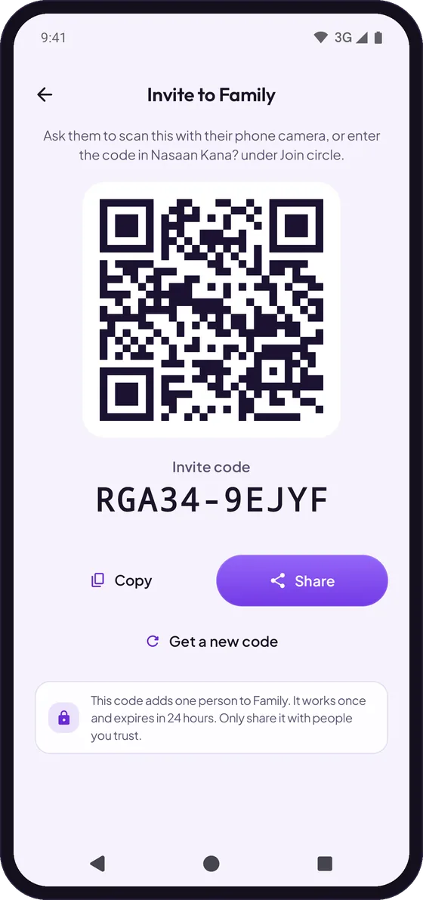</td>
    <td width="33%" align="center">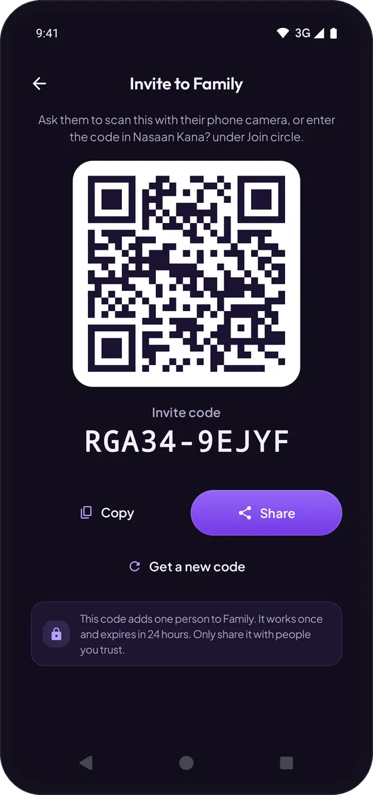</td>
  </tr>
  <tr>
    <td width="34%" valign="middle">
      <h3>10. Settings</h3>
      
Edit your profile and photo, switch between light and dark, pick a map style, turn on ghost mode or app lock, and update the app.

    </td>
    <td width="33%" align="center">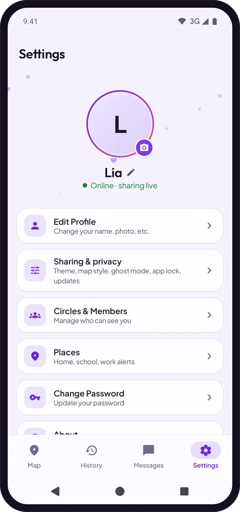</td>
    <td width="33%" align="center">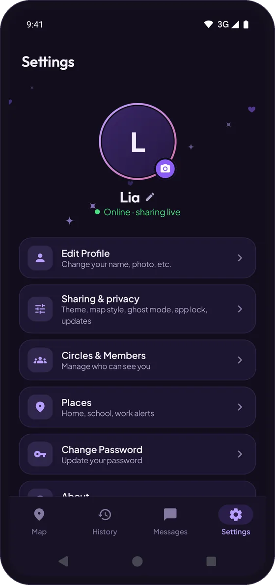</td>
  </tr>
</table>

Screens show demo data.

## Private and easy on your battery

<table>
  <tr>
    <td width="50%" valign="top">
      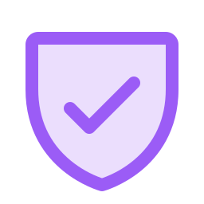 
      <b>Only your circle can see you</b> 
      End-to-end encrypted. Your location, history and messages can only be unlocked by your circle.
    </td>
    <td width="50%" valign="top">
       
      <b>Easy on your battery</b> 
      GPS turns off when you're not moving and turns back on the moment you move.
    </td>
  </tr>
  <tr>
    <td valign="top">
       
      <b>Gone after 24 hours</b> 
      History, messages, photos and videos delete themselves. Accounts that are not used for 30 days are deleted as well.
    </td>
    <td valign="top">
       
      <b>Pause any time</b> 
      Ghost mode pauses sharing. App lock keeps the app behind your fingerprint, face or PIN.
    </td>
  </tr>
</table>

No ads, no tracking, no subscriptions.

## Download

Get the newest version from **[Releases](https://github.com/Levi-crown/NasaanKana/releases/latest)**.

| File | Pick this if |
| :--- | :--- |
| `NasaanKana-x.x.x-arm64-v8a.apk` | You have a phone from the last few years. Most people need this one. |
| `NasaanKana-x.x.x-armeabi-v7a.apk` | You have an older phone. |
| `NasaanKana-x.x.x-universal.apk` | You're not sure which one. It works on every phone but is a bigger download. |

**Already have it?** You'll get a notification when a new version is out, and you can update right inside the app from **Settings**.

**Forgot your password?** Resetting it clears your data, so you'll need a new invite to join your circles again.

## Credits

| | |
| :--- | :--- |
| **Kuromi** | Character © Sanrio Co., Ltd., shown in this app as fan art. This app is not affiliated with, sponsored or endorsed by Sanrio. |
| **Map data** | © [OpenStreetMap](https://www.openstreetmap.org/copyright) contributors (ODbL) |
| **Map tiles** | [OpenFreeMap](https://openfreemap.org) |
| **Satellite imagery** | © [Esri](https://www.esri.com), Maxar and the GIS user community |
| **Weather** | [Open-Meteo.com](https://open-meteo.com) (CC BY 4.0) |
| **Map engine** | [MapLibre Native](https://maplibre.org) (BSD-2-Clause) |
| **Emoji** | Apple emoji artwork © Apple Inc., from [emoji-data](https://github.com/iamcal/emoji-data) |
| **Icons** | [Phosphor Icons](https://phosphoricons.com) (MIT) |
| **QR codes** | [ZXing](https://github.com/zxing/zxing) (Apache 2.0) |

### Built with

  
  
  
  

Plus AndroidX (WorkManager, DataStore, Navigation, Biometric, Lifecycle) and Kotlin Coroutines.

 

  Made in the Philippines by <a href="https://github.com/Levi-crown">Levi Crown</a>

